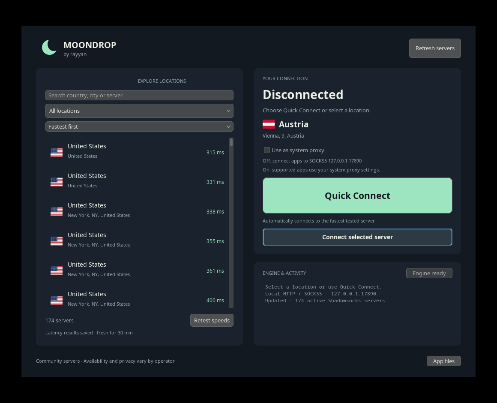

# Moondrop

by rayyan

A small, independent Java desktop client for protected Shadowsocks, VLESS, Trojan, Hysteria2, and TUIC connections from [Shadowmere](https://shadowmere.xyz/), [GFP](https://github.com/gfpcom/free-proxy-list), [V2rayCollector](https://github.com/MhdiTaheri/V2rayCollector), and [Morpheus](https://github.com/morpheusadam/v2ray-config). Dark navy, warm text, mint accents, country flags, one list, one connection. Not an official Shadowmere release.



## Install

Download from the [Moondrop v0.6.0 release](https://github.com/Sipper1236/moondrop/releases/tag/v0.6.0), currently a prerelease. **The Windows and macOS installers include a Temurin OpenJDK 21 runtime. You do not need to install Java separately for these installers.**

### Windows installer

1. Under **Assets**, download **Moondrop-0.6.0-Windows-x64.exe** for a Windows x64 PC.
2. Run the installer. It installs for your user account and creates Start menu and desktop shortcuts.
3. Open **Moondrop** from either shortcut.

This release is unsigned. Windows SmartScreen or Microsoft Defender may warn about an unfamiliar publisher. Proceed only if you trust the download and obtained it from the official release linked above.

### macOS installer

1. Open Apple menu → **About This Mac** to check your chip.
2. Download **Moondrop-0.6.0-macOS-arm64.dmg** for Apple Silicon (M1 and newer), or **Moondrop-0.6.0-macOS-x64.dmg** for Intel.
3. Open the DMG and drag **Moondrop.app** into **Applications**. If that folder is not writable by your account, use `~/Applications` instead.
4. Open Moondrop from Applications, then eject the installer disk.

This release is unsigned and is not notarized. If macOS blocks it, open **System Settings → Privacy & Security → Open Anyway** after attempting to launch, and proceed only if you trust the official download. Keep Gatekeeper enabled.

### Portable ZIP or JAR

The portable download runs on Windows (x64/ARM64), macOS (Intel/Apple Silicon), and Linux x64 with **Java 17 or newer**. Java 21 LTS is recommended. The **portable ZIP and standalone JAR do not bundle Java**. A desktop Java runtime (JRE) is enough; a JDK works too. You do not need Maven or development tools to run them. The following Java setup and launcher steps apply to these portable downloads.

#### 1. Install Java

If `java -version` already reports version 17 or newer, skip to downloading Moondrop.

##### Windows

Open PowerShell or Windows Terminal and run:

```powershell
winget install --exact --id EclipseAdoptium.Temurin.21.JRE
```

Close and reopen the terminal, then run:

```powershell
java -version
```

Prefer an installer? Download [Eclipse Temurin 21](https://adoptium.net/temurin/releases/?version=21), choose **Windows**, package type **JRE**, your CPU architecture (usually **x64**), and the **MSI** installer. Run it and keep **Add to PATH** enabled. Reopen the terminal to check the version. The JRE package is listed in [Microsoft's WinGet catalog](https://github.com/microsoft/winget-pkgs/tree/master/manifests/e/EclipseAdoptium/Temurin/21/JRE). See [Microsoft's Java setup instructions](https://learn.microsoft.com/en-us/windows/dev-environment/java).

##### macOS

**Automatic setup:** download and extract Moondrop below, then double-click `installmacos.command`. It checks for Java 17+ with desktop support. If missing, it downloads the correct Temurin 21 installer for Intel or Apple Silicon, verifies its SHA-256 checksum and macOS package signature, and asks for administrator authorization to install Java separately. It then opens Moondrop. No Homebrew is needed.

For manual installation instead:

Download [Eclipse Temurin 21](https://adoptium.net/temurin/releases/?version=21), choose **macOS**, and install the **PKG**:

- **Apple Silicon** (M1, M2, M3, and newer): choose **aarch64**.
- **Intel Mac**: choose **x64**.

Apple menu → **About This Mac** identifies your chip. If you already use Homebrew, you can instead install [Temurin 21](https://formulae.brew.sh/cask/temurin@21):

```sh
brew install --cask temurin@21
```

Open a new Terminal window and check:

```sh
java -version
```

##### Linux

Install the desktop runtime for your distribution. Do not choose a package with only `headless` in its name: Moondrop needs a graphical desktop.

**Ubuntu 24.04 or newer** ([package](https://packages.ubuntu.com/openjdk-21-jre)):

```sh
sudo apt update
sudo apt install openjdk-21-jre
```

**Debian 12 or newer** ([default runtime](https://packages.debian.org/bookworm/default-jre), Java 17 on Debian 12):

```sh
sudo apt update
sudo apt install default-jre
```

**Fedora** ([Java 21 package](https://packages.fedoraproject.org/pkgs/java-21-openjdk/java-21-openjdk/)):

```sh
sudo dnf install java-21-openjdk
```

If your Fedora release no longer provides Java 21, install its current desktop OpenJDK runtime (Java 17 or newer) or use the [Temurin installer instructions](https://adoptium.net/installation/linux/).

**Arch Linux** ([Java 21 package](https://archlinux.org/packages/extra/x86_64/jre21-openjdk/)):

```sh
sudo pacman -Syu jre21-openjdk
```

Check the installed version:

```sh
java -version
```

#### 2. Download the portable archive

1. Open the [Moondrop v0.6.0 release](https://github.com/Sipper1236/moondrop/releases/tag/v0.6.0). This is a prerelease.
2. Under **Assets**, download **Moondrop.zip**. The same archive works on all supported operating systems; it contains Moondrop and launchers, without Java.
3. Extract the entire ZIP. On Windows and macOS, keep that folder for running Moondrop. On Linux, the installer below copies the app to a stable location in your user account. Do not run from inside the ZIP.

You can also download **moondrop.jar** alone and run it with `java -jar moondrop.jar`.

#### 3. Open the portable app

**Windows:** double-click `launch-windows.bat` in the extracted folder. Alternatively, open a terminal in that folder (right-click the folder background → **Open in Terminal**) and run:

```powershell
java -jar .\moondrop.jar
```

**macOS:** first double-click `installmacos.command` to check/install Java and open Moondrop. For later launches, use `launch-macos.command`. If the setup needs executable permission, open Terminal, change into the extracted folder, and run:

```sh
cd "$HOME/Downloads/Moondrop"
chmod +x installmacos.command
./installmacos.command
```

Replace the example folder path with wherever you extracted Moondrop. You can also run `java -jar moondrop.jar` from that folder.

**Linux:** open a terminal in the extracted folder and install the app-menu shortcut:

```sh
chmod +x install-linux.sh
./install-linux.sh
```

Then open **Moondrop** from your application menu. No `sudo` is needed, and Java stays a separate installation. The installer copies the app to `${XDG_DATA_HOME:-$HOME/.local/share}/moondrop`, creates `~/.local/bin/moondrop`, and installs `moondrop.desktop` and the SVG icon under your user data directory. The stable app folder is writable by your account so automatic updates can replace the JAR.

The repository and ZIP also include `moondrop.desktop` and `moondrop.svg`. The desktop file is a template using `Exec=moondrop` and `Icon=moondrop`; the installer writes a ready-to-use desktop entry with absolute paths.

For a portable launch without installing a shortcut, run `chmod +x launch-linux.sh` followed by `./launch-linux.sh`, or use `java -jar moondrop.jar` from the extracted folder.

### Connect

New and expired checks run **nearby first**: your approximate country comes from a direct HTTPS lookup at [IPWHOIS](https://ipwhois.io/documentation), cached locally for 24 hours. Only the country code and lookup time are saved. Moondrop compares reported server countries using country-center distances; unknown locations come last. If lookup fails, Moondrop reuses the saved country; without one, testing continues without a distance preference. A VPN or upstream proxy can affect the detected country. To override it, launch with an ISO country code, for example `java -Dmoondrop.country=CA -jar moondrop.jar`. This changes test order; measured reliability, median HTTPS latency, and a bounded download estimate decide the best tested connection.

Moondrop imports protected proxy connections from [Shadowmere](https://shadowmere.xyz/), [GFP](https://github.com/gfpcom/free-proxy-list), [V2rayCollector](https://github.com/MhdiTaheri/V2rayCollector), and [Morpheus](https://github.com/morpheusadam/v2ray-config). Supported profiles are **encrypted Shadowsocks**, **VLESS with verified TLS or REALITY**, **Trojan with TLS**, **Hysteria2 with TLS**, and **TUIC with TLS**. Plain HTTP/SOCKS proxies, plaintext VLESS, profiles disabling TLS verification, VMess, and unsupported plugins, transports, or ciphers are excluded.

The app automatically loads Shadowmere's Shadowsocks feed; GFP's Shadowsocks, Hysteria2, and TUIC feeds; V2rayCollector's Shadowsocks and mixed feeds filtered to supported protected profiles; and Morpheus's Shadowsocks, VLESS, Trojan, Hysteria2, and TUIC bundles. Identical connections are deduplicated across sources. Rows show the source; search for `GFP`, `V2rayCollector`, `Morpheus`, or `Shadowmere` to narrow the list. If one source fails, the others still load. Country flags reflect source labels when provided; unknown locations remain unknown.

For each reachable candidate, Moondrop makes **three HTTPS requests**, shows the median successful latency in milliseconds and the percentage that succeeded. Lower latency and higher reliability are better. Servers that fail the initial TCP check do not receive HTTPS samples. To estimate download speed, it downloads at most **1 MiB through each of the best five servers**, chosen by reliability then median latency: at most **5 MiB per testing pass**, rather than a download through every server. Fresh cached download measurements are skipped. The rate is an end-to-end estimate including TLS setup, not a sustained bandwidth guarantee.

Completed checks, including failures and download estimates, are cached locally for **7 days**. Results are saved as testing progresses, so closing and reopening Moondrop resumes missing checks instead of starting the full scan again. Automatic testing checks only new, changed, or expired servers. Existing working entries with one old HTTPS sample receive a three-request upgrade; the old failure cache stays intact. Older measurements remain visible until replaced. Hover a result to see when it was measured. Use **Stop testing** to pause; completed checks stay saved.

Click **Quick Connect**. Moondrop reuses the cached quality ranking and verifies the selected server again before connecting. Ranking puts complete three-request results first, then reliability, then a score combining median latency with the estimated time to transfer 256 KiB. When download speed is unknown, the score adds one second; a failed download ranks behind other results with the same quality and reliability. Without a usable cached result, Quick Connect samples up to 256 candidates across sources and countries, limits initial address checks to eight seconds, and compares HTTPS results through up to 20 responsive candidates. This is the best connection tested, not a promise about every server or download speed. Failed checks are excluded until they expire or you retest.

The cache reflects **your machine and network**; it is not a shared global ranking. After changing networks or routes, use **Retest speeds** to force a fresh check of every server, including cached successes and failures. A successful HTTPS check confirms that a server works from your current network. Actual censorship bypass depends on the network, server, and protocol configuration; TLS alone does not guarantee it everywhere.

On the first connection, Moondrop downloads its separate **sing-box networking engine** from the official upstream release and verifies its checksum. This is not a Java installation. The first launch and engine download need working internet access.

On **Windows and macOS**, enable **Use as system proxy** to route compatible applications through Moondrop. macOS may ask for permission to change network settings.

On **Linux**, configure your browser or application's proxy manually: choose **HTTP** or **SOCKS5**, host **127.0.0.1**, port **17890**. You can also use these settings in applications on Windows or macOS when system proxy mode is disabled. Moondrop is an application proxy; applications that ignore proxy settings will use their own connection.

Click **Disconnect** when finished. Close Moondrop normally so it can restore any system proxy settings it changed.

### Automatic updates

Moondrop checks this project's GitHub releases in the background at launch and every six hours. **Check for updates** retries manually. An unavailable update service does not block browsing or connections. Updates follow published preview releases as well as regular releases.

**Windows and macOS installer editions:** when **Download update** appears, click it to open the official release page. Download the installer for your platform and chip, disconnect and close Moondrop, then install the new version. On macOS, replace the existing app in the folder where you installed it. The full installer updates the app and its bundled Java together. Saved settings and connection results remain in the data folder below.

**Portable ZIP/JAR edition:** a newer JAR downloads automatically and is verified against the release's SHA-256 checksum and application version. A verified staged download is reused across launches. When **Restart to update** appears, click it when convenient. Moondrop restores proxy settings, closes its engines, waits for the app to exit, replaces the JAR, and restarts using your separately installed Java. It keeps `moondrop.jar.previous` beside the JAR as a backup. This updater does not update your separate Java installation.

Portable updates require a writable app folder; move the extracted folder somewhere you own if needed. If an update cannot install or launch, the helper keeps/restores the previous app. Logs are in the `updates` subfolder of the data folder below. You can also close Moondrop and rename `moondrop.jar.previous` back to `moondrop.jar` for manual rollback. Older portable releases without the updater need one manual upgrade.

### If it will not open

- **Portable edition: “Java not found” / “java is not recognized”:** install Java above, close and reopen your terminal, then check `java -version`. On Windows, make sure the installer added Java to PATH.
- **Portable edition: Java 8 or `UnsupportedClassVersionError`:** the launcher is finding an older Java installation. Install Java 17+ and make sure `java -version` reports the newer version before trying again.
- **Double-clicking the JAR does nothing:** use the platform launcher or `java -jar moondrop.jar` in a terminal. A JAR file association is not required.
- **Cannot find `moondrop.jar`:** extract the whole ZIP and keep the launcher beside the JAR. Run the command from that folder.
- **No display / `HeadlessException` on Linux:** use a graphical desktop session and install the desktop JRE listed above.
- **First connection fails:** check that your internet connection can reach GitHub for the engine download, then retry. Public servers can also go offline; refresh the list and try Quick Connect again.
- **Connection was interrupted and the system proxy is stuck:** reopen Moondrop and use **Disconnect** so it can recover the saved settings.

### Remove Moondrop

Disconnect and close the app. On Windows, uninstall the installer edition through **Settings → Apps → Installed apps**. On macOS, move **Moondrop.app** from Applications to the Trash. These editions remove their private bundled runtime with the app. For portable downloads, delete the extracted Moondrop folder. For a Linux app-menu installation, also remove these files and folders (replace the data directory if you set `XDG_DATA_HOME`):

- `~/.local/share/moondrop`
- `~/.local/share/applications/moondrop.desktop`
- `~/.local/share/icons/hicolor/scalable/apps/moondrop.svg`
- `~/.local/bin/moondrop`

Any separately installed Java used by the portable edition stays installed for other applications.

If you also want to remove Moondrop's downloaded engine and saved state, delete its data folder only after disconnecting successfully:

- Windows: `%LOCALAPPDATA%\Shadowmere`
- macOS: `~/Library/Application Support/Shadowmere`
- Linux: `~/.local/share/shadowmere-desktop`

These older Shadowmere folder names are retained for compatibility and proxy recovery.

## Use

1. Open Moondrop. The app loads the current active server list.
2. Click **Quick Connect**, or select a server and click **Connect selected server**.
3. On first connection, the app automatically downloads sing-box 1.14.3 for your OS and CPU from SagerNet's official GitHub release and checks its pinned SHA-256 checksum. **Install engine** also lets you prepare it ahead of time.
4. With **Use as system proxy** enabled, compatible macOS/Windows apps use the connection. Without it, configure an app to use HTTP or SOCKS5 at `127.0.0.1:17890`.
5. **Disconnect** restores the previous system proxy settings and stops this app's engine.

This is an application proxy, not a VPN or TUN tunnel. Apps that ignore system proxy settings are not covered. macOS may require network-settings permission. On Windows this configures the current user's Internet Settings, not WinHTTP. Corporate policy, automatic discovery, and applications with their own proxy settings can override it. Local mode never modifies OS proxy settings. Public proxy operators control their servers; availability and trust vary. HTTPS certificate validation stays enabled.

## Quick Connect

Reachable candidates receive three HTTPS requests using Google's connectivity endpoint. Each row shows median successful latency and reliability (successful requests out of three); servers failing the initial TCP check have no HTTPS samples. A bounded Cloudflare HTTPS download estimates end-to-end speed, including TLS setup. Only the best five servers by reliability then median latency enter this stable download shortlist, with at most 1 MiB each / 5 MiB per pass. Cached download results are reused for seven days, so restarting does not rotate downloads through the entire feed.

The connection ranking puts full three-request results first, reliability second, then median latency plus the estimated time to transfer 256 KiB. Unknown download speed adds one second to that score; failed downloads rank last within the same quality/reliability tier. This balances response time, repeated success, and a measured transfer estimate. It selects the **best tested connection**, not a globally fastest server or a sustained bandwidth guarantee.

Completed results, including failures, are saved progressively in a local **7-day cache**. Reopening resumes missing checks; automatic testing checks only new, changed, or expired profiles. Legacy cache files upgrade automatically: working one-probe entries receive three-request checks, while saved failures remain cached. Older measurements remain visible until replaced. Quick Connect reuses the cached ranking and verifies the chosen connection again. **Retest speeds** forces a fresh scan; use it after changing networks or routes because results reflect your machine and network.

When no cached server succeeds, Quick Connect samples up to 256 candidates across sources and countries, spends up to eight seconds checking TCP responsiveness, then compares HTTPS results through up to 20 responsive endpoints. Both stages keep sources represented so a large feed cannot crowd out smaller ones. Cancel stops the search and closes its temporary engine. A refresh discovers new profiles; there is no background subscription polling or silent server switching. Test endpoint availability can affect results. Supported protected protocols and successful tests do not guarantee censorship bypass on every network.

## Run from source

Requires JDK 17+ and Maven 3.9+:

```sh
mvn package
java -jar target/moondrop.jar
```

The runnable JAR works on macOS (Apple Silicon and Intel), Windows (x64 and ARM64), and Linux x64. OS proxy automation is macOS/Windows only. The first engine download requires internet access. No accounts or credentials to type.

## Downloads / packaging

The release provides Windows x64 `.exe` and macOS Apple Silicon/Intel `.dmg` installers with a bundled Temurin OpenJDK 21 runtime. It also provides the portable **Moondrop.zip** and standalone **moondrop.jar**, which require separately installed desktop Java 17+. The ZIP works on macOS (Apple Silicon and Intel), Windows (x64 and ARM64), and Linux x64; it includes launchers, the Linux user installer, desktop entry, icon, instructions, and licenses.

Build the portable ZIP with JDK 17+ and Maven 3.9+:

```sh
bash scripts/package.sh      # macOS / Linux
```

```powershell
./scripts/package.ps1        # Windows
```

Output: `dist/Moondrop.zip`. Packaging uses an explicit file list to exclude local state, downloaded engines, and runtimes from the portable archive.

Build native installers on their target operating system with Temurin JDK 21 (including `jpackage`) and Maven 3.9+. Windows also requires WiX 3 on PATH. Build the application first:

```sh
mvn package
bash scripts/package-macos.sh
```

```powershell
mvn package
./scripts/package-windows.ps1
```

The native scripts bundle the runtime and set `moondrop.distribution=native`, so update checks offer the full installer instead of replacing the installed app's JAR. macOS builds use the build machine's architecture; build once on Apple Silicon and once on Intel. Release asset names are `Moondrop-0.6.0-Windows-x64.exe`, `Moondrop-0.6.0-macOS-arm64.dmg`, and `Moondrop-0.6.0-macOS-x64.dmg`. These installers are unsigned; macOS packages are not notarized.

GitHub Actions builds the three native installers and portable downloads, and tests the native networking engine on Linux, macOS Apple Silicon, macOS Intel, and Windows. The sing-box engine downloads separately on first connection.

## Verification

```sh
mvn test
mvn -Dengine.test.path=/absolute/path/to/sing-box test
java -jar target/moondrop.jar --install-engine
java -jar target/moondrop.jar --smoke-test
```

The integration test runs a real local Shadowsocks server and client, verifies an encrypted HTTP round trip, and checks child-process/config cleanup. The smoke test fetches live servers, runs Quick Connect, verifies HTTPS through the winning server, then disconnects. Neither changes system proxy settings. Isolate data with `-Dshadowmere.dataDir=/temporary/folder` before `-jar`.

Native macOS/Windows system-proxy behavior must be acceptance-tested on those platforms, including an existing manual proxy, PAC configuration, disconnect, engine failure, forced quit, and recovery at next launch. Linux validation does not substitute for those checks.

## State and recovery

- macOS: `~/Library/Application Support/Shadowmere`
- Windows: `%LOCALAPPDATA%/Shadowmere`
- Linux: `~/.local/share/shadowmere-desktop`

Moondrop keeps the original Shadowmere-named data folders for compatibility and recovery across the rename. Only one app instance can own the proxy settings. A durable snapshot is written before system settings change and removed after restoration. An interrupted session is recovered on next launch. A force-killed app can leave system proxy settings enabled until then; reopen Moondrop to restore them. Startup terminates leftover cores only when a private ownership record matches their PID, start time, and executable; session files must belong to this app's data directory. If settings recovery fails, the snapshot is retained and a live listener is kept available while you retry Disconnect. Server passwords exist only in memory and temporary session configuration files, removed on disconnect and after startup recovery. Median latency, reliability, download estimates, their timestamps, and hashed connection identifiers are persisted in `server-performance.json`; passwords are not stored in that cache. No browsing history or server list is persisted.

## Architecture and credits

Bundled SVG flags render consistently without requiring emoji fonts. Java 17 + Swing/[FlatLaf](https://www.formdev.com/flatlaf/), Gson, Apache Commons Compress. The UI stays on the event thread; feed requests, engine installation, and connection work run off-thread. A single sing-box process provides the loopback HTTP/SOCKS endpoint and the selected protected proxy protocol. The benchmark uses one separate temporary core with isolated routing per candidate.

Shadowmere's [API implementation](https://github.com/shadowmere-xyz/shadowmere/blob/main/proxylist/views.py) supplies active server records; [SagerNet sing-box](https://github.com/SagerNet/sing-box) supplies the networking core. This project's code is GPL-3.0-or-later; dependencies retain their own licenses. See `THIRD_PARTY.md`.
